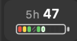
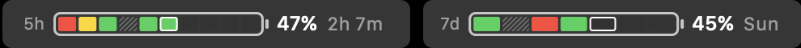

<div align="center">

# Claude Code Touch Bar Companion

**在 MacBook Pro 的 Touch Bar 上回应 Claude Code 的权限请求，顺便看住套餐用量**

Claude Code 想改文件或运行命令时，请求会以一句短摘要加几个按钮的形式出现在 Touch Bar 上。点一下，答复就通过 Claude Code 自己的 hook 结构化地传回去。不用切回终端，也不会往终端里注入任何按键。其余时间，Control Strip 里的一块小电池会显示 5 小时和每周额度还剩多少。


[设计原则](#设计原则) · [它如何工作](#它如何工作) · [套餐用量](#套餐用量) · [快速开始](#快速开始) · [路线图](#路线图)

[English](./README.md) | 简体中文

</div>

---

> **当前状态：MVP 已端到端跑通**，可以处理真实的 Claude Code 权限请求，套餐用量（5 小时 / 7 天）也已经用真实账号数据显示出来。Touch Bar 由原生 Swift 菜单栏 app 渲染，原来的 BetterTouchTool 配置保留为旧方案。


## 为什么需要它？

agentic coding 里充满了小决策：

- 要读这个文件吗？
- 要创建这个文件吗？
- 要运行这个命令吗？
- 要删除这个临时文件吗？
- 本会话剩下的编辑都允许吗？

每个决策都很小，但每次都要把你拉回终端、打断手上的事。Touch Bar 就在键盘正上方，正适合这种看一眼、点一下的交互。这个项目把它变成处理这些决策的第二个界面，而 Claude Code 的 TUI 仍然是唯一的事实来源。

## 设计原则

1. **结构化返回，不注入按键。** 答复通过 `PermissionRequest` hook 的结构化输出（`allow`、`deny`、`updatedPermissions`）传回。不往终端输入任何字符，也不依赖终端焦点。
2. **对风险保守。** 高风险和未知风险的请求永远没有一键批准，只有 `Review on screen / No`。`Review` 是把控制权交回 Claude Code，不是批准。
3. **一眼看懂。** 长路径和 Bash 命令会被压缩成 `Delete tmp`、`Run npm test` 这样的短标签。
4. **不占地方。** 只有在请求需要回答时才弹出，处理完就让回系统原本的 Touch Bar（包括 Esc）。权限请求可以打断你，用量永远不会。
5. **不对过期状态生效。** 每个请求都有新的 `request_id`；如果按钮画出来之后请求已经变了，点击会被忽略。
6. **默认只在本地。** 状态、回复和日志都在 `~/.claude-touchbar/`。日志会脱敏 prompt、assistant 消息和文件内容。唯一的联网请求是可选开启的用量查询，只发往 Anthropic 自己的 API。

## Touch Bar 上显示什么

```text
[x] [Logo Context] [Action 1] [Action 2] [Action 3]
```

| 请求 | Context 示例 | 按钮 |
| --- | --- | --- |
| `Read` | `Read PRD.md` | `Yes / Yes all session / No` |
| 带 edit suggestion 的 `Write`、`Edit`、`MultiEdit` | `Create permission-edit-test.md` | `Yes / All edits / No` |
| 低 / 中风险请求 | `Delete touchbar-test.md`、`Run npm test` | `Yes / No / Review` |
| 高风险删除或 shell 命令 | `Delete tmp` | `Review on screen / No` |
| Claude 桌面 app 回合结束时的"下一步"提问 | `Commit and push this change?` | `提交并推送 / 先不提交 / On screen` |
| 没有待处理的请求 | `CC Ready` | 无 |

在"下一步"提问上点的选项，会作为反馈传回给 Claude，回合接着进行。Touch Bar 会等 20 秒，这期间在屏幕上点按钮会被排到等待结束后才生效，想在屏幕上回答可以先点 `On screen`。详见 [docs/HOOK_SETUP.md](docs/HOOK_SETUP.md#next-step-questions-claude-desktop)。

Context 是白底的只读 item，前面可以显示 `~/.claude-touchbar/icon.png` 里的图标。按钮按含义上色：`Yes` 绿色，本会话授权蓝色，`No` 红色，Review 类灰色。

## 套餐用量

套餐的 5 小时额度和每周（7 天）额度以电池的形式显示：数字是**剩余**的电量，不是已经用掉的。





*上：Control Strip。下：点开之后。在真实 Touch Bar 上截取，数据为示例数据。*

| 层级 | 位置 | 显示什么 |
| --- | --- | --- |
| 常驻 | Control Strip，一直可见 | 当前更紧的那个窗口，比如 `5h 57` 加一条细的分段电池；电量变少时数字会变黄、再变红 |
| 按需 | 点一下 Control Strip 里的这个按钮 | 两个窗口各一条长电池，附带 5 小时的重置倒计时和 7 天的重置日 |
| 打断 | 出现权限请求时 | 平时什么都不加；只有 5 小时剩 10% 以下时，才加一个红色低电量角标 |

"更紧"指离用完更近的那个窗口。7 天窗口在剩余不多、或者用得比时间进度快时算紧；两者一样紧时优先显示 5 小时，因为它决定接下来几个小时。

每条电池都按时间分段，像 F1 的 minisector：5 小时分成 10 格，每格 30 分钟；7 天分成 7 格，每格一天。每一格按这段时间实际用量和平均份额的比较来上色：

| 格子 | 含义 |
| --- | --- |
| 绿色 | 没有超过平均节奏 |
| 黄色 | 最多是平均节奏的 1.5 倍 |
| 红色 | 超过平均节奏的 1.5 倍 |
| 白框 | 当前这一格 |
| 深灰 | 还没到 |
| 斜纹 | 没有记录，比如 app 启动之前，或者 Mac 睡眠时 |

30 分钟没有收到新数据时整条电池变灰；5 小时窗口 15 分钟内就要重置时，会出现一个充电闪电。

**数据从哪来。** 用量接口只返回"当前一共用了多少"，所以 app 每 5 分钟记一次快照，再用相邻快照的差值算出每一格。数据源有两个，写的是同一份文件：

- **你的 Claude 账号（推荐，需手动开启）。** 在菜单栏 `CC` 的菜单里打开 *Fetch Usage from Claude Account*。app 调用的是 Claude Code `/usage` 命令背后的接口，所以终端、桌面 app 和 claude.ai 的用量都会算进去。每次查询时从钥匙串读取 Claude Code 的登录 token，只在这一次请求里使用，不写盘，也不会去续期。这个接口没有公开文档，可能随时变化。
- **Claude Code status line（备用）。** [`touchbar_statusline.py`](.claude/hooks/touchbar_statusline.py) 记录 Claude Code 传给 status line 的 `rate_limits`。它只在终端会话里运行，桌面 app 不会触发。

只有 Pro、Max 和 Ultra 套餐才有用量数据。配置细节和限制见 [docs/APP_SETUP.md](docs/APP_SETUP.md#plan-usage-5h--7d)。

## 它如何工作

hook 和 Touch Bar app 之间只通过本地文件通信。请求自下而上传递，你的答复再原路返回。

```
Touch Bar app（Swift）         ← 显示 context 和按钮；点击后写入
     ▲                           responses/<request_id>.json
状态文件                       ← ~/.claude-touchbar/state.json、responses/、
     ▲                           actions.jsonl、events.jsonl
Hook（touchbar_hook.py）       ← 生成请求摘要、评估风险，
     ▲                           最多等 20 秒回复
Claude Code PermissionRequest
```

以 Claude Code 想创建一个文件为例：

1. hook 写入 `state.json`：context 为 `Create demo.md`，风险 `medium`，按钮为 `Yes / All edits / No`。
2. app 立刻察觉到变化（监听目录，不轮询），弹出 Touch Bar。
3. 你点 `All edits`。app 写入回复文件，hook 把 `allow` 和本会话的 `acceptEdits` 权限一起返回给 Claude Code。
4. Touch Bar 让回原样。如果 20 秒内没有点击，Claude Code 会回到它原本的屏幕确认流程。

## 什么时候会触发

companion 只能看到进入 Claude Code `PermissionRequest` hook 的请求，所以取决于权限模式：

| 模式 | 会触发 Touch Bar？ | 说明 |
| --- | --- | --- |
| **默认** | ✅ 需要审批时触发 | Write、Edit、Bash 通常需要审批；项目内普通 `Read` 日常不必强制审批 |
| **Accept Edits** | ⚠️ 部分触发 | Write/Edit 自动批准，Bash 仍然触发 |
| **Auto Mode** | ⚠️ 部分触发 | 低风险操作自动放行，不确定的仍然触发 |
| **Bypass Permissions** | ❌ 不触发 | 所有操作自动批准，hook 不会被调用 |
| **Plan Mode** | ❌ 不触发 | 没有工具调用，没有要审批的 |

日常使用时，把 Touch Bar 留给有副作用的操作（`Write`、`Edit`、`Bash`、删除）。测试或演示时，可以临时在本地 Claude Code 配置里加上 `permissions.ask: ["Read"]`，方便复现 `Read` 的流程，用完再删掉。

## 快速开始

需要带实体 Touch Bar 的 MacBook Pro、macOS 12 或更高版本、Python 3，以及 Swift 6 工具链（Xcode 或 Command Line Tools）。

1. 把这个项目放在 Claude Code 的工作区里。hook 已经注册在 [.claude/settings.local.json](.claude/settings.local.json)。
2. 编译并运行 Touch Bar app：

   ```bash
   cd app
   swift build
   .build/debug/TouchBarCompanion
   ```

   它以 `CC` 的形式待在菜单栏，没有 Dock 图标。想让它在后台常驻、开机自动启动，改用 `scripts/install-launch-agent.sh`（见 [docs/APP_SETUP.md](docs/APP_SETUP.md#run-in-the-background-recommended)）。
3. 触发一次 Claude Code 权限请求，在 Touch Bar 上点对应的按钮。
4. 可选：在菜单栏 `CC` 的菜单里打开 *Fetch Usage from Claude Account*，查看套餐用量。

详见 [docs/APP_SETUP.md](docs/APP_SETUP.md)；hook 的行为见 [docs/HOOK_SETUP.md](docs/HOOK_SETUP.md)。

查看发生了什么：

```bash
python3 -m json.tool ~/.claude-touchbar/state.json        # 当前状态
tail -n 1 ~/.claude-touchbar/actions.jsonl                # 最近一次点击
find ~/.claude-touchbar/responses -maxdepth 1 -type f     # 回复文件
```

## 路线图

- [x] **MVP**：基于 BetterTouchTool 的 hook 闭环、风险分级按钮、本会话授权
- [ ] **阶段 1：原生 app**：Swift app 取代 BetterTouchTool，通过权限测试矩阵（已完成）；两分钟 demo 彩排
- [ ] **阶段 2：用量和小角色**：分段电池显示套餐用量（已完成）；跟着 Claude Code 状态动的动画小角色
- [ ] **阶段 3：可配置**：用配置文件定义 Touch Bar 按钮，安全底线写死在代码里
- [ ] **阶段 4：设置窗口**：SwiftUI 按钮编辑器，带 Touch Bar 实时预览
- [ ] **阶段 5：开源分发**：hook 改写为 Swift（去掉 Python 依赖）、一键安装 hook、Homebrew cask（开机自启已经可以通过 LaunchAgent 脚本实现）

详见 [TODO.md](TODO.md)。

## 技术栈

| 层 | 选型 |
| --- | --- |
| Hook | Python 3，只用标准库 |
| Touch Bar app | Swift + AppKit，SwiftPM 构建；运行时调用未公开的 system-modal Touch Bar API |
| 通信 | 本地 JSON 文件，原子写入 |
| 用量数据 | 可选开启：从 `api.anthropic.com/api/oauth/usage` 拉取；Claude Code status line 作为备用 |
| 测试 | Swift Testing |
| 旧方案 | BetterTouchTool widgets + `scripts/btt_*.py`（[docs/BTT_SETUP.md](docs/BTT_SETUP.md)） |

## 项目结构

```text
.claude/hooks/touchbar_hook.py   # hook：写入状态，返回决策
.claude/hooks/touchbar-hook.sh   # hook shell wrapper
.claude/hooks/touchbar_statusline.py  # status line：记录套餐用量（备用数据源）
app/                             # 原生 Swift Touch Bar app（SwiftPM）
docs/APP_SETUP.md                # Swift app 配置说明
docs/HOOK_SETUP.md               # hook 行为和手动测试
docs/BTT_SETUP.md                # 旧方案：BetterTouchTool 配置
scripts/install-launch-agent.sh  # 让 app 在后台常驻、开机自启
scripts/                         # 旧方案：BetterTouchTool 脚本和 iTerm2 启动脚本
TODO.md                          # 路线图和 checklist
```

## 不做的事

- 取代 Claude Code 自己的权限界面，或绕过它的权限机制
- 往终端输入字符，或解析终端 TUI
- 管理多个 Claude Code 会话
